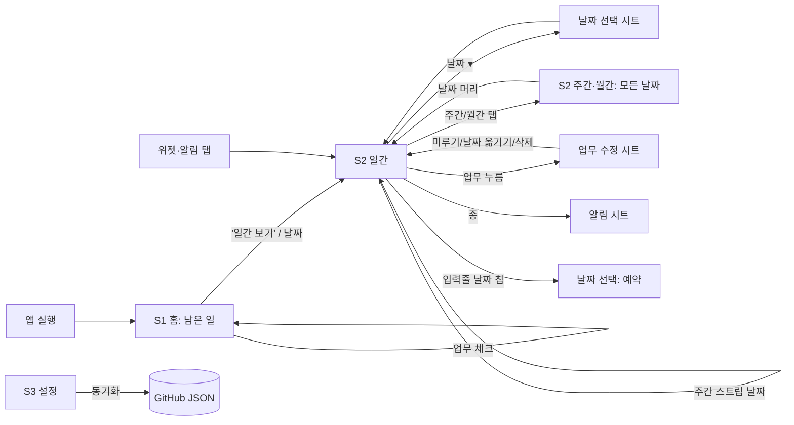

# 화면 목록·흐름도 (v2, 2026-11-25)

## 화면
| ID | 화면 | 주요 요소 |
|---|---|---|
| S1 홈 | 할 일 | 요약(오늘 남은 일·밀린 일 수), 밀린 일 + '모두 오늘로', 오늘, 예약된 일(날짜별) |
| S2 기록 | 업무 기록 | 일간/주간/월간 탭 · ‹ 날짜 ▾ › · 오늘 · (일간) 주간 날짜 스트립 · 전체/미완료/완료 칩 · 업무 목록 |
| S3 설정 | 설정 | GitHub 저장소·토큰, 연결 확인, 지금 동기화 |
| 공통 | 아래 입력줄 | [날짜 칩(오늘/예약)] [할 일 입력] [↑ 추가] |
| 시트 | 업무 수정 | 내용, 내일로·다음 주 월요일·날짜 골라 옮기기, 삭제·저장 |
| 시트 | 날짜 선택 | 년 ‹ › · 월 ‹ › · 달력(업무 있는 날 점) · 오늘로 가기 |
| 시트 | 알림 받기 | 빠른 선택, 날짜·오전/오후·시·분, 알림 끄기 |
| 안내 | 토스트 | 삭제했어요 · 되돌리기 / 예약했어요 / 오류 안내 |

## 업무 한 줄
`[체크박스] 업무 내용(여러 줄 그대로) · 메타(날짜·알림 시각·미룬 횟수) [종]`
완료하면 취소선 + 흐리게, 그날 목록 맨 아래(완료한 순서).

## 흐름도

## 토스 디자인 적용
| 항목 | 값 |
|---|---|
| 주요 채움 | blue-500 #3182F6 (추가 버튼·저장·선택 날짜) |
| 파란 글자 | blue-700 #1B64DA (대비 5.6:1) |
| 글자 | grey-900 #191F28, 보조 grey-700 #4E5968 |
| 회색 면 | grey-100 #F2F4F6 (입력칸·세그먼트·보조 버튼) |
| 라운드 | 버튼 L 14 / M 12, 시트 24, 칩 999 |
| 체크박스 | 24px, 6~7 라운드, 체크 시 파란 채움 + 흰 체크 |
| 칩 | 34px 알약, 선택은 진회색 바탕 + 흰 글자 |
| 문구 | 해요체 |
| 서체 | 시스템 서체(Pretendard 는 번들 안 함) |
